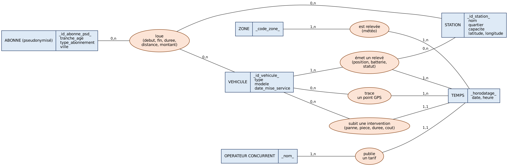
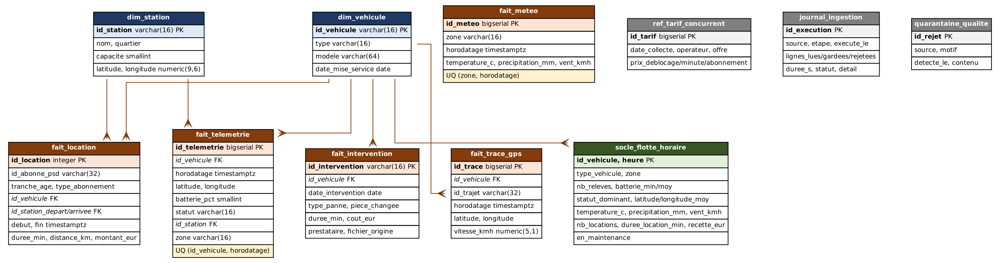

# 2. Modélisation MERISE

## 2.1 Modèle conceptuel de données (MCD)



### Entités

| Entité | Identifiant | Commentaire |
|---|---|---|
| VEHICULE | `id_vehicule` | Vélo ou trottinette électrique |
| STATION | `id_station` | Point de dépose, de capacité connue |
| ABONNE (pseudonymisé) | `id_abonne_psd` | **Aucune donnée nominative.** L'entité ne porte que la tranche d'âge, le type d'abonnement et la ville |
| TEMPS | `horodatage` | Entité de datation commune aux événements |
| ZONE | `code_zone` | Découpage météo de la métropole (centre, nord, sud, ouest) |
| OPERATEUR CONCURRENT | `nom` | Opérateur dont la grille tarifaire est relevée |

### Associations et cardinalités

| Association | Cardinalités | Attributs portés |
|---|---|---|
| VEHICULE **émet un relevé** TEMPS, STATION | (1,n) – (1,n) – (0,n) | position, batterie, statut |
| ABONNE **loue** VEHICULE, STATION | (0,n) – (0,n) – (0,n) | début, fin, durée, distance, montant |
| VEHICULE **subit une intervention** TEMPS | (0,n) – (1,1) | panne, pièce, durée, coût |
| ZONE **est relevée** TEMPS | (1,n) – (1,n) | température, précipitations, vent |
| VEHICULE **trace un point GPS** TEMPS | (0,n) – (1,n) | position, vitesse, identifiant de trajet |
| OPERATEUR **publie un tarif** TEMPS | (1,n) – (1,1) | offre, prix de déblocage, prix à la minute |

Deux cardinalités méritent justification.

**« émet un relevé » vers STATION en (0,n).** Un relevé n'est pas toujours
rattaché à une station : un véhicule en circulation ou stationné hors station
en émet aussi. Imposer (1,n) obligerait à inventer une station fictive.

**« loue » en (0,n) côté ABONNE.** Un abonné peut n'avoir jamais loué — il
figure au fichier des abonnés sans trajet. La cardinalité minimale est donc 0,
et non 1.

## 2.2 Règles de passage au modèle logique

1. **Chaque entité devient une table**, son identifiant devient clé primaire.
2. **Une association binaire de type (x,n) – (x,1)** se traduit par une clé
   étrangère dans la table du côté (x,1). C'est le cas de « subit une
   intervention » : `fait_intervention.id_vehicule`.
3. **Une association de type (x,n) – (x,n)**, ou portant des attributs, devient
   une table à part entière dont la clé est la concaténation des identifiants
   participants. C'est le cas de « loue » → `fait_location` et de « émet un
   relevé » → `fait_telemetrie`.
4. **L'entité TEMPS n'est pas matérialisée en table.** Sur une plage de cinq
   jours au pas de 15 minutes, une table de dates coûterait une jointure
   supplémentaire sur chaque requête pour n'apporter aucune information que le
   type `timestamptz` ne porte déjà. L'horodatage est donc stocké comme
   attribut, avec un index sur chaque table de faits. Une table de temps
   redeviendrait utile si des attributs calendaires métier apparaissaient
   (jours fériés, vacances scolaires, jours de grève).
5. **ZONE et OPERATEUR** restent des attributs textuels : leur cardinalité est
   trop faible (4 et 1) pour justifier une table de référence et une jointure.

## 2.3 Modèle physique de données (MPD)



Onze tables, réparties en quatre familles :

| Préfixe | Tables | Rôle |
|---|---|---|
| `dim_` | `dim_vehicule`, `dim_station` | Référentiels : peu de lignes, mises à jour rares |
| `fait_` | `fait_telemetrie`, `fait_location`, `fait_intervention`, `fait_meteo`, `fait_trace_gps` | Événements datés : volumineux, en insertion seule |
| `ref_` | `ref_tarif_concurrent` | Référentiel externe daté |
| exploitation | `socle_flotte_horaire`, `journal_ingestion`, `quarantaine_qualite` | Jeu consolidé et traçabilité |

Le DDL complet est dans [`sql/ddl/schema_postgresql.sql`](../sql/ddl/schema_postgresql.sql).

### Choix de types

- **`timestamptz` et non `timestamp`** : les sources mélangent dates naïves et
  dates horodatées. Sans fuseau, un relevé de 2 h du matin fin mars devient
  ambigu au passage à l'heure d'été. Tout est stocké en UTC.
- **`numeric(9,6)` pour les coordonnées** : six décimales valent environ 11 cm,
  largement suffisant. `float` introduirait des écarts d'arrondi sur des
  comparaisons d'égalité.
- **`numeric` et non `float` pour les montants** : un calcul financier en
  virgule flottante finit par produire 10,299999999 €.
- **`varchar(16)` pour les identifiants** : longueur connue et stable
  (`VLO-00123`), ce qui permet de borner l'index.

### Contraintes d'intégrité

Les contraintes ne sont pas décoratives : elles sont la dernière barrière si une
règle applicative est contournée.

- `CHECK (batterie_pct BETWEEN 0 AND 100)` — la source émet des `-1` et des `255`.
- `CHECK (statut IN (…))` — vocabulaire fermé, imposé en base.
- `CHECK (fin > debut)` sur `fait_location` — une location ne peut pas finir
  avant de commencer.
- `UNIQUE (id_vehicule, horodatage)` sur `fait_telemetrie` et `fait_trace_gps` —
  la déduplication applicative est doublée d'une garantie en base.
- Clés étrangères vers les deux référentiels — un relevé portant un véhicule
  inconnu est rejeté plutôt que silencieusement orphelin.

### Index

Chaque index répond à un accès identifié ; aucun n'est posé « au cas où »,
car un index inutile ralentit toutes les écritures.

| Index | Accès servi |
|---|---|
| `idx_telemetrie_vehicule_date (id_vehicule, horodatage DESC)` | Dernier état connu d'un véhicule |
| `idx_telemetrie_date (horodatage)` | Fenêtres temporelles et purge RGPD |
| `idx_telemetrie_station (id_station, horodatage) WHERE id_station IS NOT NULL` | Taux de remplissage par station. Index **partiel** : 40 % des relevés n'ont pas de station, les exclure réduit l'index d'autant |
| `idx_location_debut`, `idx_location_vehicule` | Extractions par fenêtre et par véhicule |
| `idx_intervention_vehicule` | Historique de maintenance d'un véhicule |
| `idx_socle_zone_heure` | Filtre de l'API sur zone et période |

### Évolution prévue : partitionnement

`fait_telemetrie` reçoit en production environ 17 millions de lignes par jour.
Le DDL documente le passage à une table partitionnée par mois :

```sql
CREATE TABLE fait_telemetrie (...) PARTITION BY RANGE (horodatage);
```

L'intérêt est double. Les requêtes sur une fenêtre ne lisent que les partitions
concernées. Surtout, la purge mensuelle devient un `DROP PARTITION` instantané,
là où un `DELETE` sur des dizaines de millions de lignes bloque la table et
impose un `VACUUM` coûteux.
